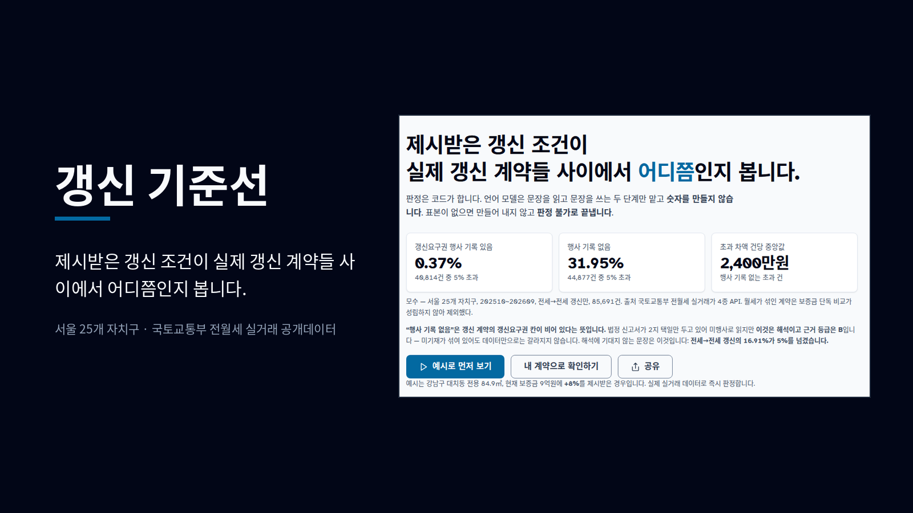
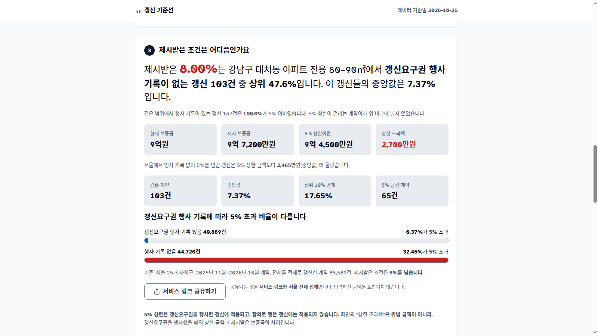
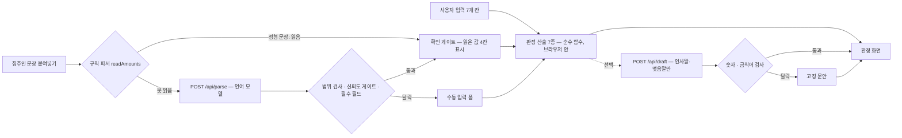

# 갱신 기준선

전월세 계약 갱신을 앞둔 세입자가, 집주인이 제시한 조건이 **같은 조건의 실제 갱신 계약들 사이에서 어디쯤인지** 공개 실거래 데이터로 확인하고 다음 행동을 정하도록 돕는 웹 서비스.



> **배포** https://gaengsin-baseline.pages.dev · **문서 색인** [docs/00-INDEX.md](docs/00-INDEX.md) · **기준일** 2026-09-18
>
> 위 이미지는 제품 첫 화면 캡처에 제목을 얹은 **합성 커버**다. 앱 화면 그대로가 아니다. 가공하지 않은 화면은 아래 [§WHAT](#what--화면에서-실제로-일어나는-일)에 있다.

---

## WHY — 왜 만들었나

### 문제

전월세 계약 갱신에서 집주인이 조건을 제시하면, 세입자는 **그 조건이 시장 어디쯤인지 모르는 채로** 답해야 한다. 기존 서비스는 신규 거래 시세를 보여 주고, 계산기는 5%를 곱해 줄 뿐이며, 공공 상담 창구는 분쟁이 터진 뒤에 열린다. **갱신 계약들의 인상률 분포**를 보여 주는 곳이 없다.

그리고 이 결정에는 **되돌릴 수 없는 기한**이 붙어 있다. 계약갱신요구권은 관공서 절차 없이 만기 6~2개월 전에 의사표시가 도달하기만 하면 되지만, 그 기간이 지나면 이번 만기에는 쓸 수 없다.

> 이 문제 정의는 **공개 데이터로 계량한 것**이지 사용자 인터뷰나 사용 로그에서 나온 것이 아니다. 사용자 조사는 하지 않았고, 도입·절감·전환 같은 성과 수치도 없다. 대상 사용자와 맥락의 근거는 [docs/01-PRD.md §3](docs/01-PRD.md)에 적혀 있다.

### 측정된 사실 (2026-09-18)

국토교통부 전월세 실거래가 4종 API를 서울 25개 자치구 × 최근 12개월(2025-10~2026-09) 호출해 직접 계산했다. 원본 596,178행, 그중 **전세→전세 갱신 85,691건**이 비교 대상이다. 월세가 섞인 계약은 보증금 단독 비교가 성립하지 않아 제외했다.

| 구분 | 표본 | 5% 초과 비율 | 상위 10% 인상률 |
|---|---|---|---|
| 갱신요구권 행사 기록 있음 | 40,814건 | **0.37%** | 5.00% |
| 행사 기록 없음 | 44,877건 | **31.95%** | 15.87% |

- 전세→전세 갱신의 **26.51%**가 정확히 +5.00%다.
- 행사 기록 없는 초과 건의 상한 대비 차액은 **건당 중앙값 2,400만원**이다. 이 값은 위법 금액이 아니라 갱신요구권을 행사했을 때의 상한과 실제 계약의 차이다.

주택 유형별로 갈린다. 행사 기록 있는 쪽은 네 유형 모두 5% 초과가 **1% 미만**이다.

| 유형 | 표본 | 행사 기록 없는 쪽의 5% 초과 | 그 집단 상위 10% |
|---|---|---|---|
| 아파트 | 56,517건 | 39.57% | 17.86% |
| 단독·다가구 | 5,070건 | 46.69% | 25.00% |
| 연립·다세대 | 17,279건 | 17.66% | 8.70% |
| 오피스텔 | 6,825건 | 8.04% | 5.00% |

> **"행사 기록 없음"은 해석이다.** 법정 신고서가 행사/미행사 2지 택일만 두고 있어 빈 칸을 미행사로 읽지만, 미기재가 섞여 있어도 데이터만으로는 갈라지지 않는다. 근거 등급 **B**이고 화면에도 그렇게 적혀 있다. 해석에 기대지 않는 문장은 이것이다 — **전세→전세 갱신의 16.91%가 5%를 넘겼다.**
>
> **모수를 섞지 않는다.** 위 숫자는 전부 한 계열이다(국토부 4종 API · 서울 25개 자치구 · 최근 12개월). 화면·문서·OG 메타의 값은 항상 `dist/data/anchors.json` 에서 오고, 어긋나면 `node scripts/test_anchors_docs.mjs` 가 깨진다. 제품을 정하기 전 서울시 파일로 같은 질문을 먼저 물었고 그 계열은 모수가 달라 [docs/01-PRD.md](docs/01-PRD.md) 부록 A에만 둔다.

### 이 서비스가 정하지 않는 것

- **앞으로의 시세를 예측하지 않는다.** 신고된 결과만 보여 준다.
- **협상의 결과를 예측하지 않는다.**
- **법률 판단을 하지 않는다.** 조문은 원문과 출처를 보여 주고 링크만 건다.
- **표본이 없으면 만들어 내지 않는다.** 폴백 5단계를 다 거쳐도 표본이 없으면 "판정 불가"로 끝낸다.

---

## WHAT — 화면에서 실제로 일어나는 일

시나리오 셋으로 설명한다. 셋 다 현재 배포본에서 동작하는 경로이고, 각각 어디까지 검증했는지는 [§근거](#근거--무엇을-어디까지-쟀나)에 적었다.

### S1. 조건을 제시받은 세입자 (주 경로)

| 단계 | 사용자가 하는 것 | 제품이 보여 주는 것 |
|---|---|---|
| 입력 | 주택 유형·자치구·법정동·건물명·전용면적·만기일·현재 보증금/월세, 제시받은 조건 — **7개 칸뿐** | 이름·연락처·동·호수·계약서 파일은 **받는 칸 자체가 없다** |
| 기준선 | — | 갱신 요구가 열리는 날, **마감일**, 만기일. 선택지 셋(행사·합의·무행동)과 각각의 실거래 결과 |
| 판정 | 「판정하기」 | 제시 인상률이 **같은 단지·면적대 코호트에서 상위 몇 %**인지, 5% 상한 금액과 차액, 표본 수, 행사 기록 유무별 분포 |
| 문안 | 「이 숫자로 회신 문안 만들기」(선택) | 회신 문안. **숫자가 든 문장은 전부 코드가 쓴다** |

아래는 배포본을 그대로 찍은 판정 화면이다(예시 입력: 강남구 대치동 전용 84.9㎡, 보증금 9억원, +8% 제시).



**끝나는 조건과 멈추는 조건.** 화면이 끝나는 방식은 전부 열거돼 있다(M-01~M-11, O-01~O-06 — [docs/02-SPEC.md §5](docs/02-SPEC.md)). 주요한 것 셋:

- **서울 밖**이면 분포 판정을 하지 않는다. 대신 5% 상한 금액과 인상률은 보여 준다 — 입력값만으로 되는 산술이고 5% 상한은 지역과 무관한 법정 기준이다.
- **표본이 얇으면** 폴백 5단계(단지·면적대 → 단지 전체 → 법정동·면적대 → 법정동 → 자치구)로 넓히고, 어느 단계에서 나온 숫자인지 화면에 적는다. 그래도 0건이면 **판정 불가**다.
- **단지 단위 비교는 아파트에만** 한다. 원천이 단지 일련번호를 주는 유형이 아파트뿐이고, 나머지 세 유형은 596,178행 전부 비어 있다.

### S2. 읽은 값이 미심쩍을 때 — 되묻는다

집주인 메시지를 붙여넣으면 금액을 읽어 입력 칸에 넣는다. 여기에 방어선 둘이 있다.

- **확인 게이트**: 읽은 값 4칸(현재 보증금·제시 보증금·제시 월세·전용면적)을 **전부 화면에 보여 주고**, 사용자가 「맞습니다」를 누르기 전에는 입력 칸에 들어가지 않는다.
- **자릿수 되묻기(M-11)**: 금액이 10배 틀려도 종전과 제시가 같은 배율이면 인상률이 정상이라 어떤 비율 검사도 통과한다. 그래서 바깥 기준이 필요하다 — 같은 코호트의 신규 전세 보증금 중앙값과 대조하고 1/3~3배 밖이면 **판정을 멈추고 되묻는다.** 버리는 것이 아니라 되묻는 것이다.

### S3. 언어 모델이 끊겼을 때 — 제품은 완주한다

판정 산술 7종은 **브라우저 안에서** 돈다. 모델이 죽어도 판정 숫자는 그대로 나온다.

| 끊긴 곳 | 그때 화면 |
|---|---|
| `/api/parse` 실패·타임아웃 | `E_UPSTREAM` → "직접 넣어 주세요" + 수동 입력 폼 |
| `/api/draft` 실패·검증층 불통과 | 고정 인사말로 대체. **숫자 문장은 코드가 만들므로 내용이 같다** |
| 정적 자산 로드 실패 | 분포 판정만 중단. 만기 계산·5% 상한·환산은 계속 동작 |

---

## HOW — 어떻게 돌아가나

### 언어 모델이 맡는 것과 맡지 않는 것



**판정 경로에 언어 모델이 없다.** 판정은 산술 7종(법정 기한, 인상률, 5% 상한 차액, 코호트 백분위, 행사 기록 유무별 분포, 신규 시세 대비 차액, 환산 부담률)뿐이고 전부 순수 함수다(`dist/assets/rules.js`). 같은 입력이면 항상 같은 출력이 나온다.

| | 결정론(코드) | 언어 모델 |
|---|---|---|
| 판정 산술 7종 | ✅ 전부 | — |
| 문장 → 금액 (정형 문장) | ✅ 규칙 파서, 브라우저 안 | — |
| 문장 → 금액 (그 밖) | 범위 검사·신뢰도 게이트·필수 필드 검사 | ✅ `gpt-5.4-mini`, Structured Outputs |
| 회신 문안의 숫자 문장 | ✅ 전부 | — |
| 회신 문안의 인사말·맺음말 | 숫자·금칙어 검사 | ✅ 같은 모델 |

**정형 문장은 서버로 나가지 않는다.** `"전세 3억5천인데 3억8천으로"` 같은 문장은 규칙 파서(`rules.js` `readAmounts`)가 브라우저 안에서 읽고, 읽으면 `/api/parse` 를 부르지 않는다. 합격 기준은 처리율이 아니라 **조용한 오수락 0건** — 골든셋의 모든 문장에서 "정확한 값" 또는 "읽지 않음" 둘 중 하나여야 한다. 문법을 좁게 둔 이유가 그것이다(한글 수사·역순·금액 하나는 읽지 않는다).

### 데이터가 어디서 어디로 가는가

```
빌드타임 (개발자 머신)                        런타임 (사용자 브라우저)
국토부 4종 API 약 1,200회
  → 596,178행
  → 전세→전세 갱신 85,691건        정적 자산 fetch (자치구 샤드 1개 ≈ gzip 40KB)
  → 코호트 11,715개                  → 판정 산술 7종 ← 여기서 끝난다
  → 건물 색인 5,908개                     ↘ 문장 읽기·문안 (선택) → Functions → OpenAI
  → dist/data/*.json
```

**런타임 외부 호출은 OpenAI 하나뿐이다.** 원천 API도 지도 서비스도 런타임에 부르지 않는다. 그래서 사용자가 늘어도 공개 API 한도가 소진되지 않는다. 원본 596,178행은 배포물 어디에도 없다.

**의존성 0개.** 빌드 도구도 프레임워크도 쓰지 않는다. 표준 라이브러리와 브라우저 기본 기능만 쓴다.

자세한 것은 [docs/03-ARCHITECTURE.md](docs/03-ARCHITECTURE.md), 함수 인터페이스와 오류 코드는 [docs/04-API.md](docs/04-API.md)에 있다.

---

## 근거 — 무엇을 어디까지 쟀나

### 오프라인 검사 6종 (키·네트워크 없이 돈다)

```bash
./scripts/test_all.sh
```

2026-09-20 실행 결과 — `전부 통과`, 종료 코드 0.

| 스크립트 | 무엇을 잡는가 | 결과 |
|---|---|---|
| `build_assets.py --selftest` | 전세→전세 판별, 면적 구간, 폴백 사다리, 5% 초과 집계, 자산 게이트 8종 | ok |
| `test_rules.mjs` | 판정 산술 7종 + 규칙 파서 + 평가셋 라우팅 동결 + **면적 계약** | ok — 32건 |
| `test_verify.mjs` | LLM 출력 검증층, 오리진 경계, 프롬프트·스키마 해시 동결, **면적 계약·본문 바이트 상한·힌트 구성·업스트림 폴백** | ok — 13건 |
| `test_contrast.mjs` | 색 대비. 다크모드는 스크린샷으로 안 잡혀 수치로 본다 | ok — 36쌍 |
| `test_anchors_docs.mjs` | 스냅샷 ↔ 문서·OG 메타 대조 + **정본 다섯 문서의 Why→What→How 프레임워크**. 자산을 다시 만들면 **문서를 같이 고치기 전에는 통과하지 않는다** | ok — 716건 |
| `test_source.mjs` | 소스 금지 패턴(eval·비밀값·로그 경계), **HTML·CSS 가 외부 오리진 자산을 참조하지 않는지**, 제3자 글꼴 고지 포장 | ok — 24건 |

**검사 통과는 "결함이 없다"가 아니라 "이 검사가 보는 범위에서 회귀가 없다"는 뜻이다.** 없는 것은 [docs/05-TEST.md §8](docs/05-TEST.md)에 그대로 적혀 있다.

### 언어 모델 선택 — 무엇을 잰 측정인가

모델은 **결과를 보기 전에 기준을 동결하고** 골든셋으로 비교해 골랐다. 채택은 `gpt-5.4-mini`.

2026-09-19에 채택 모델만 현재 배포 중인 지시문·스키마로 다시 쟀다.

| 잰 것 | 값 |
|---|---|
| 모수 | 골든셋 21건 중 **규칙 파서가 6건을 가로채고 모델이 보는 15건** × 3회 반복 = **45시행** |
| 금액 3칸 완전 일치 | **45/45** |
| 서버 3관문(범위 검사·신뢰도 게이트·필수 필드)을 **틀린 채 통과**한 시행 | **0** |
| 스키마 밖 필드 생성 · 금액 날조 · 면적 날조 | 0 / 0 / 0 |
| 금액이 없는 문장 9시행 | 9/9 `null` 반환 |
| 모델 호출 지연 p50 / p95 | 1,021ms / 1,540ms |
| 시행당 토큰 (입력 / 출력 / 합, 평균) | 567 / 107 / 674 |

**이 수치가 말하지 않는 것을 먼저 적는다.**

- **"사용자에게 100% 정확하다"가 아니다.** 손으로 만든 21건짜리 골든셋의 부분집합에서 45시행 동안 오답이 없었다는 뜻이다. 실사용 문장 분포는 원문을 저장하지 않으므로 잴 경로가 없다.
- **자치구 힌트 경로는 검증되지 않았다.** 골든셋 21건의 `hint` 가 전부 `null` 이라, 제품이 실제로 붙이는 `[자치구: …]` 접두는 이 측정에서 한 번도 전송되지 않았다.
- **면적을 "읽는" 정확도는 측정되지 않았다.** 모델이 보는 15건에 면적 기대값이 있는 케이스가 0건이다. 위 표의 "면적 날조 0"은 **없는 값을 만들지 않았다**는 뜻이지 읽어 냈다는 뜻이 아니다.
- **비용은 청구액이 아니다.** 45시행의 토큰 사용량에 공식 단가표(확인 2026-09-19)를 곱한 값이 $0.0409다. 이 값은 문장 읽기 45회의 비용이고 세션 전체 비용이 아니다.
- **지연은 모델 호출 구간**이다. 사용자 체감 응답 시간이 아니다.

**원자료는 저장소에 없다.** 평가 기록은 `.gitignore` 안의 로컬 리서치 영역에 있고 공개 저장소에서 재현할 수 없다. 저장소 안에서 재현 가능한 부분은 **동결된 지시문·스키마 해시**뿐이며, 그것은 `node scripts/test_verify.mjs` 가 매번 대조한다. 요약과 한계는 [docs/05-TEST.md §10](docs/05-TEST.md)에 있다.

### 보안 경계

배포 후 실제 응답으로 확인한 것만 적는다(2026-09-18~19). 전체 표와 실측 조건은 [docs/03-ARCHITECTURE.md §7](docs/03-ARCHITECTURE.md)에 있다.

| 경계 | 무엇을 막는가 | 막지 못하는 것 |
|---|---|---|
| 오리진 검사 | 남의 사이트가 제 페이지에서 우리 엔드포인트를 불러 **우리 OpenAI 키를 쓰는 것** | **호출자 인증이 아니다.** 브라우저만 오리진을 못 속인다 — `curl` 로 위조하면 통과한다 |
| 속도 제한 | 버스트. IP당 분 10회(parse)·5회(draft) | 카운터가 아이솔레이트 메모리라 **천천히 두드리는 남용은 막지 못한다** |
| CSP `default-src 'none'` · 보안 헤더 8종 | 주입 스크립트 실행, 클릭재킹, 다운그레이드, 리퍼러 유출 | 헤더 존재는 값과 응답 커버리지가 옳다는 증명이 아니다 |
| 외부 오리진 0 (글꼴 자가 호스팅) | 제3자 브라우저 자산이 우리 모르게 바뀌는 것 | **서버 쪽 외부 의존이 없다는 뜻이 아니다.** 런타임 아웃바운드로 OpenAI 하나가 있다 |
| 모델 출력 경계 | 확인 줄에 들어가는 모델 값은 **계약을 지난 숫자만**이다(금액 `fmtMoney`, 면적 `fmtArea`) | 2026-09-19 이전에는 면적만 검사 없이 들어갔고 CSP 없는 환경에서 스크립트가 실행됐다 — 고쳤고 회귀 검사로 묶었다([F-12](docs/07-FINAL-REVIEW.md)). **이 수정은 로컬이며 배포본에는 아직 없다** |
| 출력 이스케이프 | XSS. 사용자 문자열이 닿는 자리는 `esc()` 를 지난다 | 정적 점검 범위 |
| 비밀값 경계 | `.env` 는 이력에 없고 배포물에 키가 없다 | 이 저장소 범위의 확인이다. 계정 전체를 보증하지 않는다 |

**이 경로의 최종 방어선은 제공자 쪽 지출 한도다.** 엣지 레이트리밋(WAF)은 자체 도메인이 있어야 걸 수 있고 `*.pages.dev` 에는 걸 수 없다.

[docs/06-NIST-REVIEW.md](docs/06-NIST-REVIEW.md)에 NIST 4종 참조 기준 136개 통제 대조가 있다 — **인증이 아니라 대조 기록**이고, 충족 0 · 부분충족 56 · 미충족 48 · 미확인 11 · 해당없음 19이다. 이번 제출 직전 검토는 [docs/07-FINAL-REVIEW.md](docs/07-FINAL-REVIEW.md)에 있다.

---

## 직접 해 보기

### 배포본에서 (설치 없음, 비용 없음)

1. https://gaengsin-baseline.pages.dev 를 연다.
2. **「예시로 먼저 보기」** 를 누른다 — 강남구 대치동 전용 84.9㎡, 보증금 9억원에 +8%를 제시받은 경우로 즉시 판정된다. **모델 호출 0회**다(판정은 브라우저 안에서 끝난다).
3. 「받은 문장 붙여넣기」 탭에 `전세 3억5천인데 3억8천으로 올려달라고 하시네요` 를 넣고 「문장에서 금액 읽기」 — 이 문장도 **모델 호출 0회**다. 규칙 파서가 브라우저 안에서 읽고, 화면이 "서버로 보내지 않았습니다"라고 적는다.
4. 「이 숫자로 회신 문안 만들기」 만 모델을 부른다(1회).

### 로컬에서 재현

**키 없이 도는 것** — 이 셋은 네트워크도 자격증명도 쓰지 않는다.

```bash
./scripts/test_all.sh                        # 검사 6종. 몇 초
python3 scripts/build_assets.py --selftest   # 집계 로직 자체 검증
python3 scripts/build_assets.py --from-cache # 수집 캐시로 재집계 (캐시가 있을 때)
```

**공공 API 키가 필요한 것** — 국토교통부 공개 API 키다. 무료이고 모델 호출이 아니다.

```bash
cp .env.sample .env                          # 발급처는 .env.sample 주석에 있다. .env 는 커밋하지 않는다
set -a; . ./.env; set +a
python3 scripts/build_assets.py              # 수집 → 집계 → 검증 → dist/data 출력 (약 3분, 약 1,200회 호출)
python3 scripts/build_assets.py --retry      # 429 등으로 빠진 조합만 다시 받는다
```

**함수까지 띄우려면** — `OPENAI_API_KEY` 가 있어야 문장 읽기·문안 생성이 동작한다. **여기서부터 유료 호출이 발생한다.**

```bash
npx wrangler pages dev dist                  # 로컬 실행 (함수 포함)
```

수집분은 `data/raw-rows.json.gz` 에 남는다(커밋하지 않는다). 집계 스키마를 고칠 때 1,200회를 다시 부르지 않기 위한 캐시다.

배포 환경변수는 호스팅 대시보드에서 넣는다 — `OPENAI_API_KEY`(필수), `OPENAI_MODEL`(시크릿으로 설정돼 있다. 비워도 코드 기본값이 같은 `gpt-5.4-mini` 라 평가되지 않은 모델로 내려가지 않는다 — `functions/api/_llm.js`). **원천 API 키는 배포 환경에 넣지 않는다** — 런타임이 원천을 호출하지 않으므로 필요 없다.

---

## 문서

**[docs/00-INDEX.md](docs/00-INDEX.md) 부터 읽으면 된다** — 5분·15분·60분 경로와 "무엇을 하러 왔나"별 순서가 있다. 각 문서가 무엇의 **정본**인지는 그 문서 §0 정본 지도에 있다.

### 다섯 정본 문서

| 문서 | 무엇의 정본인가 |
|---|---|
| [docs/01-PRD.md](docs/01-PRD.md) | 문제·사용자·범위와 비범위·성공 지표·제약. **무엇을 만들지 않는가**의 정본 |
| [docs/02-SPEC.md](docs/02-SPEC.md) | 입력 명세, **산술 규칙 R1~R7**, 화면 문장, 상태 분기 M·O, AI 두 단계와 검증층. **판정이 무엇인가**의 정본 |
| [docs/03-ARCHITECTURE.md](docs/03-ARCHITECTURE.md) | 구성요소와 책임, 데이터 파이프라인, 배포, **신뢰 경계와 보안**, 용량, 장애 폴백, 대안 기각 |
| [docs/04-API.md](docs/04-API.md) | 원천 API 측정 기록, 집계 자산 JSON 스키마, **함수 인터페이스와 오류 코드**, 키·환경변수, 재현 절차 |
| [docs/05-TEST.md](docs/05-TEST.md) | 검사 6종, 데이터 게이트 8종, 골든셋, **LLM 평가 증거와 그 한계**, 아직 없는 것 |

### 보조 문서

| 문서 | 내용 |
|---|---|
| [docs/00-INDEX.md](docs/00-INDEX.md) | 읽는 경로, **정본 지도**, 문서별 한 줄 |
| [docs/00-GLOSSARY.md](docs/00-GLOSSARY.md) | 용어와 **쓰지 않기로 한 말** |
| [docs/06-NIST-REVIEW.md](docs/06-NIST-REVIEW.md) | NIST 4종 참조 기준 136개 통제 대조 — **인증이 아니라 대조 기록** |
| [docs/07-FINAL-REVIEW.md](docs/07-FINAL-REVIEW.md) | 제출 직전 검토 기록 — 항목별 판정과 결함, 확인하지 못한 것 |
| [docs/STYLE.md](docs/STYLE.md) | 이 문서들을 쓰는 규칙과 배포 전 확인 |
| [COPYRIGHT.md](COPYRIGHT.md) | **저작권과 이용 조건** — 원본 구현의 권리, 제3자 구성요소 |

모든 문서는 **Why → What → How** 순서로 쓴다. 숫자의 단일 출처는 `dist/data/anchors.json` 이고, 문서가 그것과 어긋나면 검사가 깨진다.

---

## 산출물

| 파일 | 내용 | 크기 |
|---|---|---|
| `dist/index.html` | 화면 하나. 섹션 7개가 같은 판정 딕셔너리를 렌더한다 | — |
| `dist/assets/rules.js` | 판정 산술 7종 + 규칙 파서. 순수 함수, 외부 의존 없음 | — |
| `dist/data/cohort/<자치구>.json` × 25 | 코호트 11,715개 + 단지 색인 5,908개(원천이 일련번호를 주는 유형은 아파트뿐) | 최대 270KB (gzip 39KB) |
| `dist/data/anchors.json` | 서울 전체 상수. 모수를 값 옆에 함께 담는다 | 1.3KB |
| `functions/api/parse.js` | 문장 → 계산 입력. 판정하지 않는다 | — |
| `functions/api/draft.js` | 문안의 **인사말·맺음말만** 생성 | — |
| `dist/og.png` | 공유 카드(1200×630). 2026-09-18 앵커 값으로 만든 **정적 파일**이고 생성 스크립트가 없다 — 이미지 안 숫자는 사람이 확인한다([docs/05-TEST.md §8](docs/05-TEST.md)) | — |

사용자 1인당 전송량은 자치구 샤드 1개 + 색인 ≈ **gzip 40KB**다.

---

## 한계

- **신고된 결과이지 예측이 아니다.** 앞으로의 시세도 협상의 결과도 예측하지 않는다.
- **계산 범위는 서울이다.** 서울 25개 자치구 × 최근 12개월만 집계했다. 서울 숫자를 다른 지역에 적용하지 않는다.
- **`계약구분`이 비어 판정에서 빠지는 행이 596,178행 중 13,104행(2.20%)** 있고, 신고와 정정에 시간이 걸리므로 최근 계약일수록 표본에서 빠질 수 있다.
- **단독·다가구는 원천에 건물명·지번이 없어** 같은 건물끼리 비교할 수 없다. 같은 법정동·비슷한 면적으로 비교한다.
- **"행사 기록 없음"은 근거 등급 B인 해석이다**(위 WHY 참조).
- **법률 자문이 아니다.** 개별 계약의 법적 판단은 전문가에게 확인해야 한다. 화면 하단에 주택임대차분쟁조정위원회 / 대한법률구조공단(☎132) / 서울시 전월세보증금지원센터를 상시 안내한다.
- **운영 감시가 없다.** 요청 본문을 로그에 남기지 않는 설계의 대가다. 내용 없는 집계 신호만 흘려보내고 보관하지 않는다([docs/06-NIST-REVIEW.md §4](docs/06-NIST-REVIEW.md)).

---

## 개인정보

**수집하지 않는 것이 정책이 아니라 구조다.** 이름·연락처·주민번호·동·호수·소득 정보를 받는 입력 항목이 없고, 파일 업로드 엔드포인트가 없으며, 붙여넣은 메시지는 구조화 직후 버린다. 선택 기록은 브라우저 로컬에만 남는다. 서버에 데이터베이스가 없고 요청 본문을 로그에 남기지 않는다.

**외부로 나가는 것은 하나다** — 규칙 파서가 읽지 못한 문장이 `/api/parse` 를 거쳐 OpenAI로 간다. 정형 문장은 나가지 않는다.

## 데이터 출처

| 출처 | 용도 | 이용 조건 |
|---|---|---|
| 국토교통부 전월세 실거래가 (아파트·연립다세대·단독다가구·오피스텔) | 갱신 계약, 갱신요구권과 종전 조건 | 이용허락 제한 없음 |
| 서울시 부동산 전월세가 정보 | 초기 탐색 계열(부록 A) | 공공누리 1유형 (출처표시) |

두 출처는 같은 신고 원장에서 나오므로 독립 검증이 아니라 보완 관계로 쓴다. 본문 숫자는 국토부 계열 하나에서만 온다.

글꼴 — [Atkinson Hyperlegible](https://www.brailleinstitute.org/freefont/), Copyright 2020 Braille Institute of America, Inc. SIL Open Font License 1.1, 자가 호스팅. **라이선스 전문을 글꼴과 같은 자리에 함께 배포한다** — `dist/assets/fonts/OFL.txt`(4,352B). 출처와 검사 방법은 [COPYRIGHT.md](COPYRIGHT.md) §3.

## 이 저장소의 권리

**오픈소스 라이선스로 공개하지 않는다.** 원본 구현의 권리는 소유자에게 있고, 라이선스 파일이 없다는 것은 재사용 허락이 **없다**는 뜻이다(출처: [choosealicense.com — No License](https://choosealicense.com/no-permission/), 확인 2026-09-19).

배포된 서비스를 쓰는 것은 다르다 — **누구나 화면의 숫자와 생성된 회신 문안을 자기 계약 협상에 그대로 쓸 수 있다.** 제한하는 것은 소스 코드의 복제·수정·재배포·상업적 재사용이다.

전문과 제3자 구성요소 조건은 [COPYRIGHT.md](COPYRIGHT.md) 에 있다.

## 이 README 를 읽는 사람

대회 제출 폼에는 **저장소 링크 항목이 없다**(로그인 후 폼 확인 2026-09-17). 심사위원이 받는 것은 서비스 링크·이미지·500자다. 따라서 이 문서는 심사 자료가 아니라 **유지보수자·협업자·포트폴리오 문서**다. 저장소는 비공개로 둔다.
